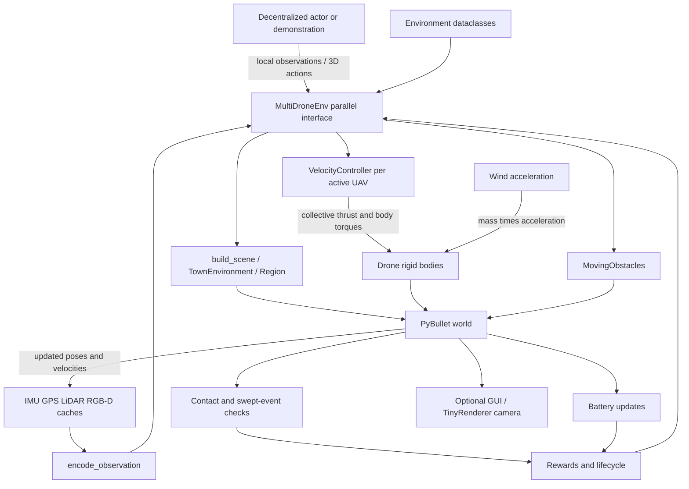

# PyBullet3D multi-UAV navigation environment

This document describes the frozen implementation in this directory. Source code is authoritative where older root-level notes or historical benchmark descriptions differ. Commands are run from the `MultiUAV-MAQRL` project root, not from `env/`.

## 1. Environment Overview

`MultiDroneEnv` provides a simulated common-source/common-destination navigation task for multiple UAVs. Each active agent receives a compact local numerical observation and chooses a normalized world-frame desired velocity. Independent low-level controllers translate these commands into forces and torques; PyBullet integrates the rigid bodies and supplies contact, ray-casting and rendering services.

The intended cooperative objective is for every required UAV to enter the destination safely. Independent failures do not immediately stop surviving agents. The implementation supports configurable fleet sizes, with regression coverage for **2, 4, 8, 16 and 20** UAVs. This coverage establishes initialization/interface operation, not a guarantee of successful cooperative navigation.

Three scenes share the same interface: `urban`, `open_field`, and `cluttered` (`indoor` is an accepted configuration/CLI alias). GUI and headless DIRECT connections are supported. The environment itself contains no policy learning, neural networks, replay buffers or MARL optimization. Algorithm implementations elsewhere in the project are separate from this documentation.

## 2. Environment Architecture

| Module | Responsibility |
|---|---|
| [__init__.py](__init__.py) | Public exports: `TownConfig`, `TownEnvironment`, `DroneConfig`, `Drone`, `EnvConfig`, `MultiDroneTownEnv`, `MultiDroneEnv`. |
| [multi_drone_env.py](multi_drone_env.py) | Parallel dictionary API; reset, control scheduling, physics steps, sensors, battery, rewards, agent lifecycle and episode statistics. |
| [town_sim.py](town_sim.py) | `TownEnvironment`: urban ground, road grid, reserved-plot filtering, seeded building construction and height queries. |
| [scenes.py](scenes.py) | `build_scene`: dispatches the urban builder or constructs open-field/indoor static geometry. |
| [drone.py](drone.py) | `Drone`: rigid body, collision sphere, enlarged compound visual, physical state, thrust/torque application and conservative collision-event sweep. |
| [drone_controller.py](drone_controller.py) | `VelocityController`, `HoverController`, quaternion rotation error, actuator/rate limits and rotation conversion helpers. |
| [navigation.py](navigation.py) | `Region` box membership/overlap/GUI edges and `spawn_positions` capacity-checked shuffled lattices. |
| [obstacles.py](obstacles.py) | `MovingObstacles`, linear/waypoint/back-and-forth trajectories and wind acceleration. |
| [sensors.py](sensors.py) | `StateSensor`, `IMUSensor`, `GPSSensor`, `GeometrySensor`, `LiDARSensor`, `RGBDCamera`, and metric-depth conversion. |
| [observations.py](observations.py) | `observation_size` and `encode_observation`: fixed local feature layout and normalization. |
| [battery.py](battery.py) | Independent normalized `Battery` charge and phenomenological consumption. |
| [rewards.py](rewards.py) | `reward_components`: per-agent decomposed rewards. |

Environment dataclasses are defined in [../config/environment_config.py](../config/environment_config.py). [../main.py](../main.py) is a standalone demonstration/visualization driver; it does not generate the world or integrate the physical equations.



## 3. Simulation Scenarios and Town Generation

### Urban

The side length is \(L=n s\), where `blocks_per_side` is \(n\) and `plot_spacing` is \(s\). Defaults give **15 × 15 plots and 195 m side length**. Road strips lie at \((k-n/2)s\), for \(k=0,\ldots,n\), along each horizontal axis. Default road width is 4 m. Ground and roads have static collision geometry; road strips are slightly elevated above the ground.

Each eligible plot is occupied with a count determined by

\[
N_{\mathrm{buildings}}=\operatorname{round}(N_{\mathrm{eligible}}\rho),
\]

where \(\rho\) is `building_density`. For **64 eligible plots and density 0.65**, the implementation selects `round(41.6) = 42` buildings. This is a proportion of eligible plots, not occupied area or built volume. Python's `round` applies; plot reservation changes the eligible denominator.

Before shuffling, plots whose maximum possible building envelope intersects a source/destination region are excluded. The remaining plots are shuffled by the supplied NumPy generator. Width and depth are sampled uniformly between 3 m and `plot_spacing - road_width - 1`; base height is sampled between the configured height limits. Default dimensions allow widths/depths from 3 to 8 m and base heights from 5 to 35 m.

The random shape is `box`, `tower`, `stepped`, or `cylinder`. Towers add a 2.4 m roof element; stepped shapes add 0.26 times the base height; cylinders use radius half the smaller sampled footprint dimension. Colors are sampled from the existing muted building palette. Roof components also have collision geometry. `height_at` is a conservative footprint-height helper, not a ray-cast sensor.

### Open field

`build_scene` creates static ground without roads or buildings. Building density does not affect this scene. The same region, dynamics, sensing, observation and action interfaces remain in use.

### Cluttered indoor

The scene has ground, four walls and a ceiling. Horizontal interior wall faces align with \(L/2+\texttt{world_margin}\); the ceiling begins at `max_altitude + radius`. Up to fourteen boxes/cylinders are considered at seven longitudinal stations, with randomized widths/depths and heights. Candidates outside bounds or intersecting reserved regions are skipped. A central x-directed corridor is kept clear using `max(3, 3*radius)` clearance. Obstacle heights vary from 4 m to the smaller of 20 m and 60% of the ceiling elevation. The layout is not an indoor aerodynamic model.

### Regions and spawning

`Region(center, half_size)` represents an axis-aligned 3D box. With source/destination `grid_shape=(2,3)`, default half sizes are **(13, 19.5, 3) m**, and centers are **(-84.5, 0, 12) m** and **(84.5, 0, 12) m**, respectively. Explicit `center` and `half_size` override the corresponding derived values. These volumes reserve two plot depths by three plot widths; they are drawn with green source edges and blue destination edges.

`contains(position, radius)` checks

\[
|p-c|+r\mathbf 1\le h+10^{-9},
\]

componentwise, so the entire physical collision sphere must fit. Arrival uses this volume test rather than `goal_radius` or one exact coordinate.

Spawns use a 3D lattice inset by the collision radius, with spacing `2.5*radius` (1.375 m by default), shuffled with the episode RNG. Positions are distinct, sphere-contained and rejected if they intersect static-body AABBs. Capacity is checked for both regions; static clearance filtering is performed for the source. UAV altitude can vary across the source volume; `spawn_altitude` specifies its default center, not an identical altitude for every UAV. Initial velocities are zero and quaternions are identity. Region/scene reservation protects the destination; moving-obstacle path envelopes also avoid both regions.

Reset rejects overlapping regions, ground/flight-limit conflicts, out-of-world bounds and insufficient lattice capacity. Default grid reservations require `2*depth < blocks_per_side` and `width <= blocks_per_side` when half sizes are derived. Thus a valid `TownConfig` alone does not guarantee a feasible region/fleet combination.

## 4. UAV Kinematics and Nonlinear Dynamics

The physical state returned by `Drone.physical_state()` is

\[
x=[p_x,p_y,p_z,v_x,v_y,v_z,q_x,q_y,q_z,q_w,\omega_x^W,\omega_y^W,\omega_z^W]\in\mathbb R^{13}.
\]

World and body frames are right-handed; world +Z is up and body +Z is the thrust direction. The xyzw quaternion maps body axes into world axes through rotation matrix \(R\). PyBullet returns world-frame angular velocity \(\omega^W\); the controller uses \(\omega^B=R^T\omega^W\).

The ideal rigid-body equations underlying the plant are

\[
\dot p=v,\qquad m\dot v=-mg e_3+TRe_3+F_w,
\]
\[
\dot R=R[\omega^B]_\times,\qquad
I\dot\omega^B=\tau^B-\omega^B\times(I\omega^B),
\]

where \(e_3=(0,0,1)^T\), \(T\ge0\) is collective thrust in newtons, \(\tau^B\) is body torque in N·m, and \([\cdot]_\times\) is the cross-product matrix. Contacts add PyBullet solver effects beyond these free-flight equations.

`Drone` creates a positive-mass rigid body with a spherical physical envelope. The implementation approximates the mass distribution as a uniform solid sphere:

\[
I=\tfrac25 mr^2 I_3.
\]

Defaults are \(m=1.2\) kg, \(r=0.55\) m, \(g=9.81\) m/s², and diagonal inertia **0.1452 kg·m²**. Damping is explicitly zero and restitution is zero. This is an internally consistent sphere approximation, not measured quadrotor inertia.

`apply_control(thrust, body_torques)` transforms the body thrust/torques into world coordinates, applies thrust at the center of mass and queues the wrench without stepping physics. `apply_wrench` adds an optional world-frame external force. `p.stepSimulation()` alone integrates position, velocity and quaternion. Normal flight does not teleport or manually integrate state. The old `Drone.control()` raises `NotImplementedError`; the environment correctly uses `VelocityController.compute()` and `Drone.apply_wrench()` instead. `state()` retains the compatibility tuple `(position, velocity, Euler angles, world angular velocity, quaternion)`.

The enlarged arms/rotor disks are base-attached visual shapes and follow the body's quaternion. `visual_scale=4` does not change mass, inertia or the collision sphere. Visual arms can overlap scenery or other visual UAVs beyond the physical envelope without a collision event.

**Reference scope.** Elmokadem and Savkin (2021), [A Hybrid Approach for Autonomous Collision-Free UAV Navigation in 3D Partially Unknown Dynamic Environments](https://www.mdpi.com/2504-446X/5/3/57), provides navigation context, but its Section 2 uses a nonholonomic kinematic model. The above Newton–Euler/quaternion plant must not be presented as an exact reproduction of that publication's equations or parameters. The sphere inertia, PyBullet contacts, quaternion feedback and actuator limits are implementation choices; exact agreement with another intended 2021 publication has not been established.

## 5. Hierarchical Flight Controller

The active pipeline is

**normalized policy action → desired world velocity → velocity PD/PID → constrained thrust direction → quaternion attitude PD → thrust/body torque → PyBullet**.

There are three clocks: policy/environment steps at `control_hz` (20 Hz), controller updates at `low_level_hz` (120 Hz), and physics at `physics_hz` (120 Hz). Required divisibility is

\[
f_{physics}\bmod f_{low}=0,\qquad f_{low}\bmod f_{policy}=0.
\]

One default policy step contains six physics ticks. Held control outputs are reapplied every tick because PyBullet clears force accumulators after stepping.

### Velocity loop

For limited desired velocity \(v_d\), error \(e_v=v_d-v\), and controller period \(\Delta t_c\),

\[
\hat a=(v_k-v_{k-1})/\Delta t_c,\quad
 a_{raw}=k_p e_v-k_d\hat a+k_i\eta.
\]

The first derivative estimate is zero. In PD mode the integral contribution is omitted. In PID mode, \(\eta\) is incremented by \(e_v\Delta t_c\) only when \(\|e_v\|\le\texttt{velocity_integral_error_gate}\), then limited per axis to `velocity_integral_limit`. Horizontal commanded acceleration is norm-limited by `max_accel_xy`; vertical acceleration is limited by `max_accel_z`. Optional `max_jerk` limits the Euclidean acceleration-command change to \(j_{max}\Delta t_c\).

With \(s=a_d+ge_3\), the vertical component is lower-bounded by `minimum_specific_thrust`. Horizontal components are limited to

\[
\|s_{xy}\|\le s_z\tan\theta_{lim},\quad
\theta_{lim}=\min(\texttt{max_tilt},\texttt{max_roll},\texttt{max_pitch}).
\]

The desired body Z axis is \(b_{3d}=s/\|s\|\), with an upward fallback for a near-zero magnitude. A horizontal heading from `yaw_target` supplies \(h=(\cos\psi_d,\sin\psi_d,0)\); the other desired axes are formed using normalized cross products. The resulting desired rotation is converted directly into a quaternion.

### Attitude loop and saturation

The error quaternion is \(q_e=q^{-1}\otimes q_d\), choosing the shortest sign-equivalent rotation. `body_rotation_error` returns the corresponding rotation vector \(e_R\) in current body coordinates. The inner loop computes

\[
\omega_{ref}=\operatorname{clip}((k_R/k_\omega)e_R,\pm\omega_{max}),
\quad
\tau=\operatorname{clip}(I k_\omega(\omega_{ref}-\omega^B),\pm\tau_{max}),
\]
\[
T=\operatorname{clip}(m\,s^TRe_3,0,T_{max}).
\]

Roll/pitch rate references use `max_angular_rate`; yaw uses `max_yaw_rate`. Per-axis `max_body_torques` override scalar `max_torque`; `max_collective_thrust` overrides `max_thrust_factor*m*g`. These constrain references and outputs, not actual rates, tilt or velocities after wind/contact forces.

PID anti-windup restores previous integral components where integration would push acceleration/tilt/jerk/thrust feasibility farther into saturation; torque saturation freezes all integral components. Reset constructs fresh controllers, clearing integral/derivative histories. Conservative defaults retain PD; PID reduces constant-wind residual velocity but can worsen some transients.

A zero velocity command brakes velocity toward zero and supplies gravity-compensating thrust at level attitude. It does **not** hold an exact x/y/z position. `HoverController` separately offers fixed-altitude/yaw stabilization with vertical position and velocity feedback; it is not the controller used by `MultiDroneEnv`.

## 6. Sensor Simulation

All sensor instances are per-UAV with independent seeded NumPy generators. Reset creates fresh bias states/caches and initial readings. Sensor updates use simulation timestamps, not GUI frames. When acquisition is not due, the last reading is retained. Frequencies are quantized to available physics ticks; scheduling chooses the first eligible tick at/after a deadline rather than interpolating measurements.

| Sensor | Value/output | Frame | Default acquisition |
|---|---|---|---|
| IMU (`IMUSensor`) | `[ax, ay, az, wx, wy, wz]` | Local world axes | 50 Hz |
| GPS (`GPSSensor`) | Position `(x,y,z)` | Local Cartesian world | 10 Hz |
| LiDAR (`LiDARSensor`) | `ground_truth_m`, `distance_m`, `normalized` | Body scan directions rotated into world for rays | 108 ranges, 10 Hz |
| RGB-D (`RGBDCamera`) | `rgb` uint8 `[H,W,3]`, `depth_m` float32 `[H,W]` | Body-mounted camera | Disabled; 64×64 at 5 Hz when enabled |

### IMU and GPS

IMU linear acceleration is the finite difference of post-physics world velocities over a physics tick. It includes actual disturbance/contact response. It is **not body-frame specific force**, and gravity is not removed to simulate a real accelerometer. Angular velocity is PyBullet's world angular velocity, not Euler angle rates.

Both state sensors use \(y=x+b+\epsilon\), with zero-mean independent Gaussian noise. IMU has a six-value bias and optional random-walk drift \(\Delta b\sim\mathcal N(0,\sigma_b^2\Delta t)\) per component at measurement updates. One IMU noise scalar applies numerically to all acceleration/angular components despite their differing units. GPS has a fixed three-value bias and Gaussian position noise, with no drift implementation. Ground truth remains available through rigid-body state; noisy GPS never changes it.

`read()` returns copies of measurements plus `timestamp`, `frequency_hz`, `frame`, `units`, `bias`, and `kind` for state sensors. Geometry sensors instead return `value`, `timestamp`, `frequency_hz`, `kind`, `frame`, and `enabled`. Disabled geometry sensors return `value=None`. Bias metadata is diagnostic simulator information, not part of local policy observations.

### LiDAR

Directions are precomputed in vertical-layer-major order. Default horizontal angles span 360° without duplicating the endpoint; elevations are (-20°, 0°, 20°). For narrower horizontal FOVs the endpoints are included. Directions are rotated by the full current body quaternion. `p.rayTestBatch` detects collision bodies including buildings, UAVs, ground and moving obstacles.

Ray starts are offset by `radius + 0.0001` m to avoid self-hits; ends are at `lidar_range`. A hit fraction \(f\) becomes \(d=d_0+f(r_{max}-d_0)\). Misses, and any residual self-hit, produce maximum range. Gaussian distance noise is applied, clipped to [0, range], then divided by range. Consequently a noisy miss may be below maximum even though its ground-truth miss is maximum. There is a near-body blind zone; a self-hit is not retried to find a farther obstacle. Ray geometry is cached at construction; reset is required after changing ray-layout configuration.

### RGB-D

The camera eye is \(p+R\,\texttt{camera_offset}\), looks along body +X and uses body +Z as up. `getCameraImage` uses `ER_TINY_RENDERER`, configured FOV/aspect/clipping, and the current rigid-body quaternion. OpenGL depth-buffer value \(z_b\) is converted to optical-axis metres by

\[
d=\frac{f n}{f-(f-n)z_b},
\]

where \(n\) and \(f\) are near/far planes. This is optical-axis depth, not radial range. No camera noise, lens distortion, rolling shutter or occlusion-aware self-body masking is implemented. Enlarged visuals may be visible to the camera even though LiDAR sees the smaller collision envelope.

Raw measurements are accessible through `get_sensor_readings(agent)` and `infos[agent]['sensors']`. Images are excluded from the compact observation. Copying image caches into infos still has a cost even when no new image is rendered. The legacy generic `SensorConfig.enabled` flag is not a master sensor switch; IMU/GPS are always instantiated and LiDAR/camera use their own enable flags.

## 7. Observation and Action Spaces

The class inherits Gymnasium `Env` but returns per-agent dictionaries. It is a **Gymnasium-space-based parallel interface**, not an ordinary single-agent Gymnasium environment or strict PettingZoo `ParallelEnv`.

Each declared action space is `spaces.Box(-1.0, 1.0, shape=(3,), dtype=np.float32)`. All active IDs must be present, and inactive/unknown IDs are rejected. Arrays must have three finite components in [-1,1]. The environment maps

\[
v_{cmd}=(u_x v_{xy,max},u_y v_{xy,max},u_z v_{z,max}).
\]

The controller additionally limits the horizontal norm to \(v_{xy,max}\), so simultaneous full x/y inputs do not command \(\sqrt2 v_{xy,max}\).

### Exact default observation layout

Python slices are half-open. Every output is float32, clipped to [-1,1], checked for finiteness and validated against its declared Box.

| Slice | Inclusive indices | Length | Content and normalization |
|---|---|---:|---|
| `0:3` | 0–2 | 3 | GPS-derived position divided by \(P=(L/2+margin,L/2+margin,z_{max})\). |
| `3:6` | 3–5 | 3 | Ego world velocity divided by \(V=(v_{xy,max},v_{xy,max},v_{z,max})\). |
| `6:8` | 6–7 | 2 | Sine and cosine of current yaw. |
| `8:9` | 8 | 1 | Actual battery level in [0,1]. |
| `9:12` | 9–11 | 3 | Destination center minus cached GPS position, divided by \(2P\). |
| `12:36` | 12–35 | 24 | Four neighbour slots, each relative position/radius (3), then relative velocity/(2V) (3). |
| `36:40` | 36–39 | 4 | Neighbour-validity masks (0 or 1). |
| `40:148` | 40–147 | 108 | Layer-major normalized LiDAR distances. Disabled LiDAR supplies ones. |
| `148:151` | 148–150 | 3 | IMU linear acceleration / `imu_acceleration_scale`. |
| `151:154` | 151–153 | 3 | IMU angular velocity / `imu_angular_scale`. |
| `154:157` | 154–156 | 3 | Cached GPS position / P (repeated by the current encoder). |

For configurable neighbour count \(K\) and ray output count \(D\), the size is \(21+7K+D\). Defaults \(K=4,D=36\times3\) give **157**, independent of fleet size. Changing K/ray layout changes network input size and must be treated as a different interface configuration.

Neighbours are active UAVs within `neighbour_radius`, ordered by Euclidean distance and then string agent ID; each slot is zero-padded when missing. This is ideal range-limited relative-state sensing based on simulator truth, without noise or occlusion; it is not access to every UAV. Ego velocity/orientation are ideal state features. Local actors receive no complete obstacle list, raw images or global state.

`global_state()` is separate privileged information: UAV position, velocity, active flag and battery dictionaries; static obstacle metadata; moving-body positions; destination center. It is not a fixed-width numerical tensor. External algorithm adapters may select an explicit numeric projection without changing local observations or environment semantics. Fleet ordering for such adapters should follow `possible_agents`, not lexicographic sorting (`uav_10` would sort before `uav_2`).

## 8. Dynamic Obstacles and Environmental Disturbances

`MovingObstacles` uses zero-mass bodies with collision geometry and red visuals: boxes, spheres or cylinders, with size parameter uniformly sampled between 1.5 and 3 m by default. Box half extents and sphere/cylinder radius use this size; cylinder height is twice size. These are **airborne obstacles**, not road vehicles.

Default coordinate bounds are \((-0.8H,-0.8H,3)\) to \((0.8H,0.8H,z_{max}-2)\), where \(H=L/2+margin\). Three waypoints are sampled inside size-inset bounds. Their entire enclosing path box must avoid source/destination, static-body AABBs, initial UAV bodies and previously created obstacle bodies. Up to 2,000 candidates are attempted per obstacle; infeasibility raises an error. This conservative rejection can favor high-altitude paths in urban scenes. It does not reserve mutually disjoint future path envelopes for every obstacle.

| `trajectory` | Behavior |
|---|---|
| `linear` | Traverses the sampled waypoint polyline at constant speed and stops at its end. |
| `waypoint` | Closes and repeatedly traverses the waypoint loop. |
| `back_and_forth` | Reverses along the segment joining first and last waypoints; intermediate point is unused. |

Positions use accumulated fixed-step simulation time, independent of GUI rate. GUI paths are red debug lines; obstacle text labels are absent. `count=0` disables moving objects. Obstacles remain on their bounded waypoint paths, with no reactive avoidance. UAV collision checks combine actual contacts and conservative sphere/expanded-AABB segment events; there is no swept relative-motion test for moving obstacles.

Wind is an optional world-frame acceleration field, uniform in space:

\[
a_w(t)=a_0+A\sin(2\pi f_w t),\qquad F_w=m a_w(t).
\]

`enabled=False` returns exactly zero wind. No random gust process or spatial variation is implemented. Constant and sinusoidal vector components are configured centrally. The force is applied at each UAV center of mass every physics tick; no position/velocity changes are imposed directly.

`reset(seed=...)` seeds scene selection, spawn shuffling, obstacle initialization and per-agent sensor generators. Explicitly reusing a seed reproduces tested CPU trajectories under the same configuration. `reset(seed=None)` continues generator state rather than restarting the configured seed. Physics/software/device differences can affect reproducibility; seeds are not a cross-platform bitwise guarantee.

## 9. Battery and Energy Consumption

Each UAV owns a fresh `Battery` and normalized charge \(b\in[0,1]\). At physics period \(\Delta t_p\),

\[
\dot E=c_h+c_v\|\bar v\|^2+c_a\|\hat a\|^2+c_z\max(0,\bar v_z),
\quad \Delta E=\min(b,\max(0,\dot E\Delta t_p)),
\]
\[
b^+=\max(0,b-\Delta E),\qquad
\bar v=(v^-+v^+)/2,\quad \hat a=(v^+-v^-)/\Delta t_p.
\]

Defaults: `initial_charge=1`, `hover_rate=0.0001`, `motion_rate=0.00001`, `acceleration_rate=0.00001`, `climb_rate=0.00002`. Rate units are normalized charge/s with the corresponding inverse squared-speed/acceleration or climbing-speed factors; consumption is **not joules or motor power**. Contacts can contribute large finite-difference acceleration costs.

With `terminate_on_depletion=True`, depleted agents receive zero thrust/torque for remaining substeps, still experience gravity/wind and terminate at the policy-step outcome check. With False, charge stays at zero but control/episode activity continue. `energy_consumed` in infos is policy-step consumption; `total_energy_consumed` is accumulated depletion since reset. Retired agents no longer receive battery updates.

## 10. Reward Function

Let \(d_i=\|g-p_i\|\) be distance to the destination **center**, \(\Delta t=1/\texttt{control_hz}\), \(u_i\) the executed normalized command, \(\Delta E_i\) its policy-step energy use, and \(C_i\) a collision event. Per-agent reward is the sum

\[
r_i=w_p(d_i^- - d_i^+)+w_t\Delta t+w_u\|u_i\|^2\Delta t
+w_g\mathbb 1_{new\ arrival}+w_c\mathbb 1_{C_i}
+w_n\pi_i\Delta t+w_E\Delta E_i.
\]

Proximity uses PyBullet closest points over every other body, including static ground/roads and eligible nearby UAVs/obstacles. If \(\delta\) is the smallest returned separation within radius \(D\),

\[
\pi_i=\max_{b}\left(1-\frac{\max(0,\delta_{ib})}{D}\right),
\]

or zero when no points are returned. Default \(D=3\) m. The reward module accepts a `terminal` argument but does not use it: a non-collision failure does not automatically receive the collision penalty. A collision takes precedence over simultaneous arrival. Arrival reward is protected by `already_arrived` and active-agent retirement.

| `RewardWeights` field | Default | Contribution |
|---|---:|---|
| `progress` | 0.1 | Distance reduction, m. |
| `arrival` | 20 | One-time safe arrival. |
| `collision` | -20 | Per-step collision flag. |
| `proximity` | -1 | Proximity severity × policy dt. |
| `energy` | -1 | Normalized energy consumption. |
| `time` | -0.01 | Policy dt; set zero to disable. |
| `effort` | -0.001 | Squared normalized action × policy dt. |

Weights are in `config/environment_config.py`, are configurable and are not established as optimal. Simulator truth is allowed for reward computation; this does not expose global truth to actors. Team reward/success rates are evaluation summaries, not extra reward terms. Individual components appear in `infos[agent]['reward_components']`.

## 11. Episode Lifecycle and Multi-Agent API

### Reset

`reset(self, *, seed=None, options=None)` returns `(observations, infos)` keyed by all newly active agents. Only `None` or `{}` options are accepted. Reset clears PyBullet, installs gravity/fixed dt, constructs and checks regions, builds the scene, samples starts, creates rigid bodies/controllers/batteries/sensors/moving obstacles, initializes sensor caches and clears rewards, statuses, arrival times and episode statistics. Stable IDs are `uav_0`, …, `uav_{N-1}` in `possible_agents`; `agents` is the current active list. Reset infos contain goal and sensor readings, not necessarily the richer step-info schema.

### Step

`step(self, actions)` returns `(observations, rewards, terminated, truncated, infos)`. It rejects stepping before reset, after close or after the active list is empty. Every active action is validated before simulation advances. Each physics substep updates obstacle time, computes/reapplies controller outputs and wind, steps all rigid bodies together, reads post-step states, updates IMU/GPS and battery, collects contacts plus swept-event checks, and refreshes geometry sensors only when due. Policy-step outcomes then compute observations, rewards, statuses and metrics.

All returned agent entries correspond to agents active **at the start of that call**, including final observations of newly finished UAVs. These agents leave `agents` before the next call. There are no stale-agent actions or repeated arrival rewards. Observations are built before retirement, so terminal observations contain the actual final physical state rather than the subsequent marker pose.

Safe arrivals record simulated arrival time and replace the body with a stationary green non-colliding sphere. Failed/truncated UAVs become red translucent non-colliding spheres. Markers retain final position/quaternion; they intentionally do not preserve the full flying UAV appearance. Surviving agents continue. Failure causes are collision, bounds, or configured depletion; altitude limits cause termination, not normal-flight state clipping.

Per-agent `terminated` means task success/failure; `truncated` means time limit without termination. Both dictionaries additionally have the legacy `__all__` flag. `terminated['__all__']` means every possible agent terminated; otherwise the episode-level truncation flag becomes true at the time limit. Team success is true only when all possible agents safely arrived. A team may end with a mix of earlier terminations and later truncations.

Step infos include goal, center-distance, success/arrival/collision/bounds flags, battery/depletion, energy, sensors, reward components, status, cumulative reward and a copied episode-statistics dictionary. Status values are `active`, `arrived`, `collision`, `battery_depleted`, `out_of_bounds`, or `truncated`. Episode statistics include steps, simulated duration, arrival count, failure count and team success; truncations are not counted as failures there.

### Render and close

`render()` returns None; GUI updates are live. It does not return an overview image in headless mode (use the sensor camera interface for RGB-D). `close()` disconnects only its own live client, empties agents and is idempotent. Context-manager cleanup is supported. `MultiDroneTownEnv` is a backward-compatible alias for `MultiDroneEnv`.

```python
import numpy as np
from config import EnvConfig
from env import MultiDroneEnv

cfg = EnvConfig(scenario="open_field", num_drones=2, gui=False,
                max_episode_steps=100)
with MultiDroneEnv(cfg) as env:
    observations, infos = env.reset(seed=42)
    while env.agents:
        # Replace with independent local actor outputs for learned execution.
        actions = {a: np.zeros(3, dtype=np.float32) for a in env.agents}
        observations, rewards, terminated, truncated, infos = env.step(actions)
        # Process final observations before dropping retired agents.
```

For time-limit bootstrapping, retain the final returned observation rather than replacing it with the next reset's observation. Ignore `__all__` when constructing agent axes. Strict Gymnasium/PettingZoo wrappers require explicit adaptation.

## 12. Configuration Parameters

All tables refer to [../config/environment_config.py](../config/environment_config.py). Values are instance configuration, separate from algorithm hyperparameters. Counts/frequencies marked positive integer reject booleans/fractional values. Runtime geometry checks impose additional feasibility conditions beyond dataclass validation.

### World, fleet, timing and rendering (`EnvConfig`, `TownConfig`)

| Field | Default | Unit / meaning | Validation or interpretation |
|---|---|---|---|
| `scenario` | `urban` | Scene name | urban/open_field/cluttered; indoor becomes cluttered. |
| `num_drones` | 8 | UAV count | Positive integer; region capacity may reject. |
| `town.blocks_per_side` | 15 | Plots per side | Positive integer. |
| `town.plot_spacing` | 13 | m | Must exceed road_width + 4. |
| `town.road_width` | 4 | m | Positive. |
| `town.building_density` | 0.55 | Eligible-plot proportion | Finite [0,1]. |
| `town.min_building_height`, `town.max_building_height` | 5, 35 | m | Positive, strictly increasing. |
| `town.seed` | 7 | Initial RNG seed | Explicit reset seed overrides RNG sequence. |
| `physics_hz`, `low_level_hz`, `control_hz` | 120, 120, 20 | Hz | Positive integer; divisibility as Section 5. |
| `max_episode_steps` | 600 | Policy steps | Positive integer; default duration limit 30 s. |
| `spawn_altitude`, `goal_altitude` | 12, 12 | Default region-center z, m | At least 2 m. |
| `world_margin` | 3 | m beyond L/2 | Positive. |
| `goal_radius` | 2 | Legacy m parameter | Validated positive; not used for box arrival. |
| `gui`, `realtime` | True, False | Connection / GUI pacing | Realtime sleeps one policy dt only with GUI. |
| `neighbour_count`, `neighbour_radius` | 4, 20 | Slots / m | Positive integer / positive radius. |
| `imu_acceleration_scale`, `imu_angular_scale` | 10, 10 | m/s² / rad/s normalization | Positive. |
| `proximity_distance` | 3 | m | Positive closest-point reward radius. |

### Physical and controller parameters (`DroneConfig`)

| Field | Default | Units / effect | Validity |
|---|---|---|---|
| `mass`, `radius`, `visual_scale` | 1.2, 0.55, 4 | kg, m, display multiplier | Finite positive; scale independent of physics. |
| `gravity` | 9.81 | m/s² | Positive. |
| `inertia_diagonal` | (0.1452, 0.1452, 0.1452) | kg·m², derived property | 2mr²/5, not a free field. |
| `min_altitude`, `max_altitude` | 0.7, 85 | m | min ≥ radius; max > min. |
| `max_speed_xy`, `max_speed_z` | 5, 2.5 | Desired m/s | Positive. |
| `max_accel_xy`, `max_accel_z` | 3, 4 | Desired m/s² | Positive. |
| `max_tilt`, `max_roll`, `max_pitch` | 0.35 each | Desired radians | Each strictly between 0 and π/2; minimum is used. |
| `max_angular_rate`, `max_yaw_rate` | 3, 1.2 | Body-rate reference rad/s | Positive. |
| `max_torque`, `max_body_torques` | 3, None | Scalar / per-axis N·m | Positive; optional tuple has 3 positive values. |
| `max_thrust_factor`, `max_collective_thrust` | 2.2, None | mg multiplier / N | Factor ≥1; explicit N limit positive, not necessarily ≥mg. |
| `max_jerk` | None | Desired acceleration slew, m/s³ | Disabled or finite positive. |
| `velocity_mode` | `pd` | Outer-loop mode | pd/pid. |
| `velocity_kp`, `velocity_kd`, `velocity_ki` | 1.5, 0.05, 0.4 | Velocity P (s⁻¹), derivative, I (s⁻²) gains | P/I positive, D nonnegative. |
| `velocity_integral_limit` | 1 | Integrated error bound per axis, m | Positive. |
| `velocity_integral_error_gate` | 0.3 | m/s | Positive norm gate. |
| `attitude_kp`, `attitude_kd` | 9, 3.5 | Angular-acceleration feedback gains | Positive. |
| `yaw_target` | 0 | rad | Any finite yaw. |
| `minimum_specific_thrust` | 0.1 | m/s² | Positive lower bound in velocity controller. |
| `hover_altitude_kp`, `hover_vertical_kd` | 2, 2.5 | Standalone hover feedback gains | Positive. |
| `min_thrust_projection` | 0.2 | Hover-loop denominator floor | Positive and ≤1. |
| `response_time`, `vel_gain`, `yaw_rate_gain` | None, 1.5, 1.8 | Legacy configuration | Not used by integrated VelocityController; response_time optional positive, other values positive. |

`max_thrust_factor` gives a default thrust cap of **25.8984 N**. `Drone.control` no longer implements the legacy response-time kinematics; do not infer current motion equations from retained legacy fields or outdated comments.

### Sensors (`SensorConfig`)

| Field | Default | Units / role | Validity |
|---|---|---|---|
| `imu_hz`, `gps_hz` | 50, 10 | Hz | Positive, ≤ physics_hz. |
| `imu_noise_std`, `gps_noise_std` | 0, 0 | IMU numeric units / GPS m | Finite nonnegative. |
| `imu_bias`, `gps_bias` | Six zeros, three zeros | Additive measurement bias | Finite tuples of length 6/3. |
| `imu_bias_drift` | 0 | Random-walk magnitude per √s | Finite nonnegative. |
| `lidar_enabled`, `camera_enabled` | True, False | Acquisition switches | Specific geometry-sensor switches. |
| `lidar_hz`, `camera_hz` | 10, 5 | Hz | Positive, ≤ physics_hz even when disabled. |
| `lidar_rays` | 36 | Rays per layer | Positive integer. |
| `lidar_fov` | 360 | degrees horizontal | (0,360]. |
| `lidar_vertical_angles` | (-20, 0, 20) | degrees | Nonempty, finite, each within ±90. |
| `lidar_range` | 30 | m | Positive and > radius + 0.0001. |
| `lidar_noise_std` | 0 | m | Finite nonnegative. |
| `camera_width`, `camera_height` | 64, 64 | pixels | Positive integers. |
| `camera_fov` | 75 | Vertical degrees | (0,180). |
| `camera_near`, `camera_far` | 0.1, 60 | m | Positive, near < far. |
| `camera_offset` | (0.6,0,0) | Body-frame m | Three finite values. |
| `enabled` | False | Legacy generic switch | Does not disable instantiated IMU/GPS or override specific switches. |
| `update_hz`, `range_m`, `noise_std` | 10, 30, 0 | Legacy generic settings | Validated but not used by concrete sensor acquisition. |

### Regions, obstacles and wind

| Group / field | Default | Units / meaning | Constraints |
|---|---|---|---|
| source/destination `grid_shape` | (2,3) | x depth / y width in plots | Two positive integers; derived-volume fit checked at reset. |
| source/destination `center`, `half_size` | None, None | Explicit 3D m | Finite center, positive half dimensions when supplied. |
| obstacles `count` | 0 | Moving-body count | Nonnegative integer. |
| obstacles `shapes` | box, sphere, cylinder | Candidate types | Nonempty supported names. |
| obstacles `trajectory` | back_and_forth | Motion mode | linear/waypoint/back_and_forth. |
| obstacles `speed` | 1 | m/s | Positive. |
| obstacles `min_size`, `max_size` | 1.5, 3 | m, size parameters | Positive, min ≤ max. |
| obstacles `bounds_min`, `bounds_max` | None, None | Derived coordinates in Section 8 | Runtime bounds/placement checks; custom bounds must leave shape clearance. |
| disturbances `enabled` | False | Wind switch | False produces zero acceleration. |
| disturbances `wind_acceleration` | (0,0,0) | World m/s² | Three finite values. |
| disturbances `variation_amplitude` | (0,0,0) | World m/s² | Three finite values. |
| disturbances `variation_hz` | 0.1 | Hz | Positive even with zero amplitude/disabled wind. |

### Battery and rewards

| Group / field | Default | Units / meaning | Validity |
|---|---|---|---|
| battery `initial_charge` | 1 | Normalized charge | Finite [0,1]. |
| battery `hover_rate` | 0.0001 | Normalized charge/s | Finite nonnegative. |
| battery `motion_rate` | 0.00001 | Charge rate / squared speed | Finite nonnegative. |
| battery `acceleration_rate` | 0.00001 | Charge rate / squared acceleration | Finite nonnegative. |
| battery `climb_rate` | 0.00002 | Charge rate / positive climb speed | Finite nonnegative; zero disables extra climb cost. |
| battery `terminate_on_depletion` | True | Episode behavior | Controls termination/zero actuation at depletion. |
| rewards `progress`, `arrival`, `collision` | 0.1, 20, -20 | Section 10 coefficients | Finite; sign not enforced by validation. |
| rewards `proximity`, `energy` | -1, -1 | Section 10 coefficients | Finite. |
| rewards `time`, `effort` | -0.01, -0.001 | Rate coefficients | Finite; zero disables term. |

## 13. Running the Environment

Install the simulator dependencies in an appropriate Python environment:

```bash
python -m pip install -r requirements.txt
```

The recorded local runtime is `/opt/anaconda3/envs/qmarl311/bin/python`. PyBullet, NumPy and Gymnasium provide the simulation; pytest is used for tests. Environment operation does not require a neural-network dependency.

The following use existing `main.py` arguments:

```bash
# Urban GUI, density and moving obstacles explicitly enabled
python main.py --scenario urban --num-drones 8 --building-density 0.65 --num-moving-obstacles 5 --seed 42 --render --realtime

# Headless open-field fleet
python main.py --scenario open_field --num-drones 20 --seed 42 --headless --max-steps 100

# Headless cluttered scene
python main.py --scenario cluttered --num-drones 16 --seed 42 --no-render --steps 100

# Two-UAV deterministic demonstration, then stationary zero-command phase
python main.py --scenario open_field --num-drones 2 --seed 42 --steps 280 --scripted-demo --render --realtime

# GUI diagnostic overlays and wider whole-town camera
python main.py --scenario urban --num-drones 8 --render --overview --velocity-vectors --directions --trails
```

`--render` is the default; `--headless` and `--no-render` are aliases and mutually exclusive with it. `--steps` and `--max-steps` are aliases. Additional implemented options are `--episodes`, `--blocks-per-side`, and `--output` for driver JSON summaries. There are no wind/PID/camera sensor CLI overrides in `main.py`; configure those through dataclass instances when using Python.

The scripted demo uses six simulation-time phases: 2 s climb, 2 s hover, 2 s forward, 2 s lateral, 2 s reverse, then zero commands. It starts airborne in the source, not on the ground. The default non-scripted controller seeks the destination with altitude adjustment and simple LiDAR repulsion; neither mode is a guaranteed collision-free planner.

Velocity vectors are green one-second measured displacements, destination direction lines are blue, and trails expire after 5 seconds. Debug aids are optional and guarded by GUI mode in the driver. Default camera distance is `0.85*L`, yaw 35°, pitch -62°, aimed at z=`0.35*max_building_height`. It is deliberately close and can crop town corners; `--overview` uses `1.35*L`. Indoor ceilings can obscure an overhead view. The driver keeps the final GUI scene open until the window is closed or Ctrl+C; `env.close()` itself closes immediately.

These are supported CLI forms verified by code/parser inspection; previous reports record real headless runs. Interactive GUI usability has not been established by a live window inspection in the recorded tool sessions.

## 14. Testing and Validation

The environment-specific baseline contains **106 tests**, separate from the larger algorithm tests. Recorded execution in [../outputs/benchmarks/maddpg_environment_tests.txt](../outputs/benchmarks/maddpg_environment_tests.txt) reports 106 passing tests. The later combined-suite report records **153 passed**, but that number includes MADDPG/integration tests and must not be called 153 environment tests. No tests were rerun for this documentation-only change.

Environment coverage includes configuration validity, battery/reward calculations, physical initialization/gravity/thrust/torque, PD/PID control, bounds/slew/saturation, three scenes × five fleet sizes, seeded reset, separation, local observations, actual contacts and conservative sweeps, moving objects, sensor acquisition/noise/cache/depth, short source-to-destination arrival, active lifecycle/truncation/close and three scenes × fleets 2/8/20 rendered with TinyRenderer. It does not certify long-horizon mission success.

To reproduce the 106-case selection:

```bash
python -m pytest -q tests/test_battery_rewards.py tests/test_collisions.py tests/test_driver.py tests/test_drone_controller.py tests/test_dynamics.py tests/test_environment.py tests/test_lifecycle.py tests/test_navigation.py tests/test_observations.py tests/test_obstacles.py tests/test_scenarios.py tests/test_sensor_integration.py tests/test_sensors.py tests/test_visuals.py
```

`python -m pytest -q` additionally runs algorithm tests. Test availability depends on installed runtime dependencies; use the recorded environment or install requirements rather than interpreting skipped simulator modules as validation success.

### Diagnostic results and profiling

| Recorded metric | Result | Interpretation |
|---|---:|---|
| Ideal level hover drift, 8 s | 0 m | Noise/wind-free rigid-body diagnostic. |
| Directional final-second mean error | 0.0153 m/s | Historical scripted-segment diagnostic, not a mission metric. |
| Attitude recovery final error | 0.000150 rad | Historical small-disturbance diagnostic. |
| Constant wind PD/PID final-second error | 0.133333 / 0.000274 m/s | Matched 20 s controller comparison. |
| Constant wind PD/PID displacement at 10 s | 1.293 / 0.480 m | PID improves rejection; not zero position drift. |
| Time-varying wind PD/PID final-second error | 0.156127 / 0.043765 m/s | Specified sinusoidal forcing, not turbulent wind. |

Sources: [dynamics summary](../outputs/dynamics/summary.json), [PD/PID comparison](../outputs/dynamics/WIND_COMPARISON.md), and [pre-MARL validation](../outputs/benchmarks/FINAL_PRE_MARL.md). PID command-change settling was slightly slower than PD in the matched test; no divergent instability was observed in those limited runs. Different historical protocols/timesteps are not interchangeable regression measurements.

The final recorded **profiled** open-field throughput, with LiDAR and 200 steps per fleet, was:

| UAVs | Run 1 steps/s | Run 2 steps/s | RGB-D + two moving obstacles steps/s |
|---:|---:|---:|---:|
| 2 | 548.1 | 545.0 | 456.5 |
| 4 | 315.6 | 319.4 | 269.2 |
| 8 | 155.1 | 158.6 | 133.6 |
| 16 | 76.8 | 77.2 | 63.8 |
| 20 | 60.7 | 58.8 | 50.0 |

cProfile, hashing and workload choices affect these values. Older unprofiled values (616/379/190/93/73) are not directly comparable. Dominant costs included controller NumPy/Python work, collision/proximity calls and sensors. Cached ray directions and specialized three-vector cross products were verified with exact output fingerprints in the measured comparisons. No sensor resolution/rate was reduced.

Reproduction tools:

```bash
python diagnose_dynamics.py
python compare_wind.py
python benchmark_step.py --label repeat --steps 200
python benchmark_step.py --label repeat_camera --steps 200 --camera --moving 2
python validate.py --steps 100 --sensor-modes state_only lidar rgbd --output outputs/validation.csv
```

The last command is simulation-benchmark mode (no `--algo`), not model-checkpoint validation. See [profiling report](../outputs/benchmarks/REPORT.md) and [final pre-MARL report](../outputs/benchmarks/FINAL_PRE_MARL.md) for self/cumulative-time distinctions and memory high-water limitations. GUI/manual playback commands are in Section 13; saved TinyRenderer images do not include GUI debug region lines.

## 15. Current Limitations

- The sphere mass/inertia envelope, aggregate thrust/torque plant and zero drag are simplified. Motor lag, rotor aerodynamics, rotor allocation, propeller interaction, real airframe inertia and sim-to-real validation are absent.
- Controller bounds constrain references/actuation, not guaranteed physical state. PD retains wind error; PID reduces it with bounded/gated integral but has transient trade-offs. Zero velocity is not position holding.
- Collision events combine actual contacts with conservative expanded AABBs. False-positive events can occur near shape corners. Relative swept collision handling for moving obstacles is absent; thin/fast contact guarantees are not established for all conditions.
- Enlarged visual geometry intentionally exceeds the collision sphere. Visible model overlap need not imply physical overlap. Arrived/failed UAVs become non-colliding markers rather than physical parked vehicles.
- Sensor timing is tick-quantized. IMU/GPS/relative neighbours are simplified, camera self-occlusion can occur, LiDAR has a near-body blind zone, and noisy misses can appear shorter than maximum. Cached readings can be stale between updates.
- The 157D vector repeats GPS position and mixes ideal state features with noisy sensors. This is the implemented interface, not an optimized observation-design claim. Some legacy dataclass fields/comments remain unused or stale.
- Obstacle placement reserves conservative bounding boxes and can fail in crowded/custom configurations. Paths do not reactively avoid future UAV or obstacle motion. The indoor corridor does not guarantee a coordinated fleet solution.
- Per-agent loops, per-body proximity queries, physics contacts, ray casting and image copies limit scalability. Reported short local benchmarks are not portable real-time guarantees.
- Close overview framing may crop edges; ceilings obscure indoor overhead views. Live GUI colors, interaction and closing have not been comprehensively inspected here. TinyRenderer initialization is not subjective GUI verification.
- Fixed-seed CPU reproducibility was tested for specific workloads; it is not a guarantee across PyBullet builds, hardware or long-duration contact trajectories.
- The API has per-agent dictionaries and legacy `__all__` keys; it is not automatically compatible with every Gymnasium/PettingZoo consumer.
- Full-town collision-free cooperative navigation, real-world fidelity and policy convergence are not demonstrated by initialization tests or short MARL smoke runs.

## 16. Future MARL Integration

The frozen boundary supplies local fixed-shape observations, normalized velocity actions, independent rewards and explicit active-agent lifecycle data. Centralized-training algorithms can access the separate `global_state()` dictionary through an external adapter while decentralized actors receive only their local vectors. Any numerical global-state projection and inactive-agent/replay masking should be defined outside the environment.

The default 157D/3D interface can support classical or quantum/hybrid policy implementations that honor its dimensions, action bounds and lifecycle contract; this is interface compatibility, not evidence of algorithmic performance or a quantum advantage. Existing algorithm internals, training procedures and hyperparameters belong in their own modules and documentation. No environment changes are required merely to exchange a compliant actor implementation.
